<a href="https://github.com/osama-bakri">
  <picture>
    <source media="(prefers-color-scheme: dark)" srcset="https://raw.githubusercontent.com/osama-bakri/Osama-Bakri/839303237898c8050ca6b80c54927f5d30c9db85/svg-dark.svg">
    
  </picture>
  

  

</a>

 

 

 

## Build. Grow faster. Ship what matters.

<table width="100%">
<tr>
<td width="50%" valign="top">

**`01` Custom Web Apps**
From spec to deployed product. End-to-end frontend engineering with clean architecture.

</td>
<td width="50%" valign="top">

**`02` WHMCS Themes & Modules**
Built, tested, and delivered. Trusted by 500+ hosting providers worldwide.

</td>
</tr>
<tr>
<td width="50%" valign="top">

**`03` Design-to-Code Delivery**
Pixel-perfect interfaces, production-ready output, zero compromise on fidelity.

</td>
<td width="50%" valign="top">

**`04` API & Integration Builds**
Custom connectors shipped as working, maintainable, documented software.

</td>
</tr>
<tr>
<td width="50%" valign="top">

**`05` Design Systems**
Component libraries and token systems that scale across products without pain.

</td>
<td width="50%" valign="top">

**`06` Performance Engineering**
Fast, optimized, built for speed from day one. LCP < 1.5s target, always.

</td>
</tr>
</table>

 

---

## Numbers

| `500+` | `50+` | `8+` | `5,979` |
|:------:|:-----:|:----:|:-------:|
| Customers | Products Shipped | Years Experience | Contributions (2026) |

 

---

## Tech Stack

 

---

## GitHub Stats

 

---

## Activity — Last 31 Days

 

---

## Trophies

<svg xmlns="http://www.w3.org/2000/svg"
     xmlns:xlink="http://www.w3.org/1999/xlink"
     width="100%" viewBox="0 0 1440 900"
     fill="none">

  <defs>
    <!-- Background -->
    <linearGradient id="bg" x1="0" y1="0" x2="1440" y2="900">
      <stop stop-color="#0B1425"/>
      <stop offset="1" stop-color="#080D18"/>
    </linearGradient>

    <!-- Panels -->
    <linearGradient id="panel" x1="0" y1="0" x2="1" y2="1">
      <stop stop-color="#111D31"/>
      <stop offset="1" stop-color="#0B1220"/>
    </linearGradient>

    <linearGradient id="featured" x1="0" y1="0" x2="1" y2="1">
      <stop stop-color="#132B50"/>
      <stop offset=".55" stop-color="#101A32"/>
      <stop offset="1" stop-color="#352078"/>
    </linearGradient>

    <!-- Chart -->
    <linearGradient id="chartLine" x1="0" y1="0" x2="1" y2="0">
      <stop stop-color="#00D6C5"/>
      <stop offset="1" stop-color="#00A8FF"/>
    </linearGradient>

    <linearGradient id="chartFill" x1="0" y1="0" x2="0" y2="1">
      <stop stop-color="#00D6C5" stop-opacity=".28"/>
      <stop offset="1" stop-color="#00D6C5" stop-opacity="0"/>
    </linearGradient>

    <!-- Badge gradients -->
    <linearGradient id="gold" x1="0" y1="0" x2="1" y2="1">
      <stop stop-color="#FFE69A"/>
      <stop offset=".5" stop-color="#F5A900"/>
      <stop offset="1" stop-color="#A95B00"/>
    </linearGradient>

    <linearGradient id="blue" x1="0" y1="0" x2="1" y2="1">
      <stop stop-color="#8DE7FF"/>
      <stop offset=".5" stop-color="#168BFF"/>
      <stop offset="1" stop-color="#2638B9"/>
    </linearGradient>

    <linearGradient id="purple" x1="0" y1="0" x2="1" y2="1">
      <stop stop-color="#F2A7FF"/>
      <stop offset=".5" stop-color="#A34BFF"/>
      <stop offset="1" stop-color="#5522C5"/>
    </linearGradient>

    <linearGradient id="green" x1="0" y1="0" x2="1" y2="1">
      <stop stop-color="#A6FFC9"/>
      <stop offset=".5" stop-color="#00C878"/>
      <stop offset="1" stop-color="#087A55"/>
    </linearGradient>

    <linearGradient id="pink" x1="0" y1="0" x2="1" y2="1">
      <stop stop-color="#FFB0D0"/>
      <stop offset=".5" stop-color="#FF477F"/>
      <stop offset="1" stop-color="#A91C59"/>
    </linearGradient>

    <!-- Glow -->
    <filter id="glow" x="-100%" y="-100%" width="300%" height="300%">
      <feGaussianBlur stdDeviation="5" result="blur"/>
      <feMerge>
        <feMergeNode in="blur"/>
        <feMergeNode in="SourceGraphic"/>
      </feMerge>
    </filter>

    <filter id="softGlow" x="-50%" y="-50%" width="200%" height="200%">
      <feGaussianBlur stdDeviation="16"/>
    </filter>

    <filter id="shadow" x="-30%" y="-30%" width="160%" height="160%">
      <feGaussianBlur in="SourceAlpha" stdDeviation="8"/>
      <feOffset dy="5"/>
      <feComponentTransfer>
        <feFuncA type="linear" slope=".35"/>
      </feComponentTransfer>
      <feMerge>
        <feMergeNode/>
        <feMergeNode in="SourceGraphic"/>
      </feMerge>
    </filter>

    <!-- Hexagon -->
    <path id="hex" d="M0 -43 L37 -21.5 L37 21.5 L0 43 L-37 21.5 L-37 -21.5 Z"/>
  </defs>

  <!-- Main background -->
  <rect width="1440" height="900" rx="20" fill="url(#bg)"/>

  <!-- ACTIVITY PANEL -->
  <rect x="35" y="30" width="1370" height="350" rx="22"
        fill="url(#panel)" stroke="#263750"/>

  <!-- Activity icon -->
  <rect x="65" y="57" width="56" height="56" rx="14"
        fill="#103C83" stroke="#197BFF"/>

  <g fill="#55D8FF">
    <rect x="79" y="84" width="7" height="16" rx="2"/>
    <rect x="92" y="72" width="7" height="28" rx="2"/>
    <rect x="105" y="64" width="7" height="36" rx="2"/>
  </g>

  <g font-family="Arial, sans-serif">
    <text x="145" y="92" font-size="27" font-weight="700" fill="#F1F5FC">Activity</text>
    <text x="260" y="92" font-size="18" fill="#9BAEC9">Last 31 Days</text>
    <text x="1340" y="90" font-size="15" fill="#DCE8FF" text-anchor="end">View More →</text>
  </g>

  <!-- Chart grid -->
  <g stroke="#284052" stroke-width="1" stroke-dasharray="4 5" opacity=".7">
    <path d="M130 145 H1340 M130 177 H1340 M130 209 H1340
             M130 241 H1340 M130 273 H1340 M130 305 H1340"/>
    <path d="M130 145 V315 M210 145 V315 M290 145 V315
             M370 145 V315 M450 145 V315 M530 145 V315
             M610 145 V315 M690 145 V315 M770 145 V315
             M850 145 V315 M930 145 V315 M1010 145 V315
             M1090 145 V315 M1170 145 V315 M1250 145 V315
             M1340 145 V315"/>
  </g>

  <!-- Chart labels -->
  <g font-family="Arial, sans-serif" font-size="14" fill="#A7B9D1">
    <text x="104" y="320">0</text>
    <text x="104" y="278">2</text>
    <text x="104" y="246">4</text>
    <text x="104" y="214">6</text>
    <text x="104" y="182">8</text>
    <text x="96" y="150">10</text>
  </g>

  <!-- Chart area -->
  <path d="M130 315
    L170 295 L210 315 L250 145 L290 315
    L330 315 L370 275 L410 315 L450 315
    L490 315 L530 275 L570 275 L610 315
    L650 315 L690 315 L730 315 L770 295
    L810 315 L850 160 L890 315 L930 255
    L970 315 L1010 315 L1050 315 L1090 315
    L1130 220 L1170 145 L1210 250 L1250 190
    L1290 250 L1340 250 L1340 315 Z"
    fill="url(#chartFill)"/>

  <path d="M130 315
    L170 295 L210 315 L250 145 L290 315
    L330 315 L370 275 L410 315 L450 315
    L490 315 L530 275 L570 275 L610 315
    L650 315 L690 315 L730 315 L770 295
    L810 315 L850 160 L890 315 L930 255
    L970 315 L1010 315 L1050 315 L1090 315
    L1130 220 L1170 145 L1210 250 L1250 190
    L1290 250 L1340 250"
    stroke="url(#chartLine)" stroke-width="3.5"
    stroke-linecap="round" stroke-linejoin="round"/>

  <!-- Chart dots -->
  <g fill="#E7FBFF" stroke="#00D6C5" stroke-width="1.5">
    <circle cx="130" cy="315" r="4"/>
    <circle cx="170" cy="295" r="4"/>
    <circle cx="210" cy="315" r="4"/>
    <circle cx="250" cy="145" r="5"/>
    <circle cx="290" cy="315" r="4"/>
    <circle cx="370" cy="275" r="4"/>
    <circle cx="410" cy="315" r="4"/>
    <circle cx="530" cy="275" r="4"/>
    <circle cx="570" cy="275" r="4"/>
    <circle cx="610" cy="315" r="4"/>
    <circle cx="770" cy="295" r="4"/>
    <circle cx="850" cy="160" r="5"/>
    <circle cx="890" cy="315" r="4"/>
    <circle cx="930" cy="255" r="4"/>
    <circle cx="970" cy="315" r="4"/>
    <circle cx="1090" cy="315" r="4"/>
    <circle cx="1130" cy="220" r="4"/>
    <circle cx="1170" cy="145" r="5"/>
    <circle cx="1210" cy="250" r="4"/>
    <circle cx="1250" cy="190" r="4"/>
    <circle cx="1290" cy="250" r="4"/>
    <circle cx="1340" cy="250" r="4"/>
  </g>

  <g font-family="Arial, sans-serif" font-size="13" fill="#A7B9D1" text-anchor="middle">
    <text x="130" y="345">23</text>
    <text x="210" y="345">25</text>
    <text x="290" y="345">27</text>
    <text x="370" y="345">29</text>
    <text x="450" y="345">31</text>
    <text x="530" y="345">2</text>
    <text x="610" y="345">4</text>
    <text x="690" y="345">6</text>
    <text x="770" y="345">8</text>
    <text x="850" y="345">10</text>
    <text x="930" y="345">12</text>
    <text x="1010" y="345">14</text>
    <text x="1090" y="345">16</text>
    <text x="1170" y="345">18</text>
    <text x="1250" y="345">20</text>
    <text x="1340" y="345">22</text>
  </g>

  <!-- TROPHIES PANEL -->
  <rect x="35" y="405" width="1370" height="465" rx="22"
        fill="url(#panel)" stroke="#263750"/>

  <!-- Trophies heading -->
  <rect x="65" y="430" width="56" height="56" rx="14"
        fill="#43218A" stroke="#914BFF"/>

  <text x="93" y="467" text-anchor="middle"
        font-size="29" fill="#E7C6FF">♜</text>

  <g font-family="Arial, sans-serif">
    <text x="145" y="465" font-size="27" font-weight="700" fill="#F1F5FC">Trophies</text>
    <text x="270" y="465" font-size="17" fill="#9BAEC9">Achievements and milestones</text>
    <text x="1340" y="462" font-size="15" fill="#DCE8FF" text-anchor="end">View All Trophies →</text>
  </g>

  <!-- BADGE 1: STAR -->
  <g transform="translate(175 550)" filter="url(#shadow)">
    <use xlink:href="#hex" fill="#2B1C0A" stroke="url(#gold)" stroke-width="3"/>
    <use xlink:href="#hex" transform="scale(.83)"
         fill="none" stroke="#FFE49A" stroke-opacity=".5"/>
    <path d="M0 -23 L7 -7 L24 -6 L11 5 L15 22 L0 13 L-15 22 L-11 5 L-24 -6 L-7 -7 Z"
          fill="#FFD34F" stroke="#FFF0A0" stroke-width="2"/>
  </g>

  <!-- BADGE 2: CUBE -->
  <g transform="translate(395 550)" filter="url(#shadow)">
    <use xlink:href="#hex" fill="#0B2345" stroke="url(#blue)" stroke-width="3"/>
    <use xlink:href="#hex" transform="scale(.83)"
         fill="none" stroke="#9AE8FF" stroke-opacity=".5"/>
    <path d="M0 -24 L21 -12 L21 12 L0 25 L-21 12 L-21 -12 Z"
          fill="#148FFF" stroke="#B8F0FF" stroke-width="2"/>
    <path d="M0 -24 L21 -12 L0 0 L-21 -12 Z" fill="#9DEAFF"/>
    <path d="M0 0 L21 -12 L21 12 L0 25 Z" fill="#148FFF"/>
    <path d="M0 0 L-21 -12 L-21 12 L0 25 Z" fill="#2672D8"/>
  </g>

  <!-- BADGE 3: CODE -->
  <g transform="translate(615 550)" filter="url(#shadow)">
    <use xlink:href="#hex" fill="#291342" stroke="url(#purple)" stroke-width="3"/>
    <use xlink:href="#hex" transform="scale(.83)"
         fill="none" stroke="#E6B3FF" stroke-opacity=".5"/>
    <path d="M-10 -14 L-25 0 L-10 14 M10 -14 L25 0 L10 14 M5 -20 L-5 20"
          stroke="#E5B2FF" stroke-width="5"
          stroke-linecap="round" stroke-linejoin="round"/>
  </g>

  <!-- BADGE 4: CONTRIBUTOR -->
  <g transform="translate(835 550)" filter="url(#shadow)">
    <use xlink:href="#hex" fill="#0A352B" stroke="url(#green)" stroke-width="3"/>
    <use xlink:href="#hex" transform="scale(.83)"
         fill="none" stroke="#A5FFD2" stroke-opacity=".5"/>
    <path d="M0 -23 L20 -12 L20 12 L0 23 L-20 12 L-20 -12 Z"
          fill="#F4B52D" stroke="#FFE6A2" stroke-width="2"/>
    <path d="M0 -15 L5 -4 L17 -4 L8 4 L11 16 L0 9 L-11 16 L-8 4 L-17 -4 L-5 -4 Z"
          fill="#087A55"/>
  </g>

  <!-- BADGE 5: ROCKET -->
  <g transform="translate(1055 550)" filter="url(#shadow)">
    <use xlink:href="#hex" fill="#10294B" stroke="url(#blue)" stroke-width="3"/>
    <use xlink:href="#hex" transform="scale(.83)"
         fill="none" stroke="#9AE8FF" stroke-opacity=".5"/>
    <path d="M-5 11 C-11 -4 4 -23 20 -24 C20 -8 10 9 -5 11Z"
          fill="#FF7952" stroke="#FFC08E" stroke-width="2"/>
    <circle cx="8" cy="-10" r="5" fill="#B9EDFF"/>
    <path d="M-8 6 L-18 18 L-5 15 M-2 14 L-4 25 L7 14"
          fill="#FFD34F" stroke="#FF9D44" stroke-width="2"/>
  </g>

  <!-- BADGE 6: HEART -->
  <g transform="translate(1275 550)" filter="url(#shadow)">
    <use xlink:href="#hex" fill="#42152F" stroke="url(#pink)" stroke-width="3"/>
    <use xlink:href="#hex" transform="scale(.83)"
         fill="none" stroke="#FFB4D2" stroke-opacity=".5"/>
    <path d="M0 18 C-9 9 -24 -2 -24 -12 C-24 -25 -6 -29 0 -15 C6 -29 24 -25 24 -12 C24 -2 9 9 0 18Z"
          fill="#FF648F" stroke="#FFB4CF" stroke-width="2"/>
  </g>

  <!-- Badge captions -->
  <g font-family="Arial, sans-serif" text-anchor="middle">
    <g fill="#F4F7FF" font-size="23" font-weight="700">
      <text x="175" y="625">500+</text>
      <text x="395" y="625">50+</text>
      <text x="615" y="625">4+</text>
    </g>
    <g fill="#A9BAD2" font-size="16">
      <text x="175" y="650">Customers</text>
      <text x="395" y="650">Repositories</text>
      <text x="615" y="650">Years Active</text>
    </g>
    <g fill="#F4F7FF" font-size="18" font-weight="700">
      <text x="835" y="625">Top Contributor</text>
      <text x="1055" y="625">Open Source</text>
      <text x="1275" y="625">Helpful</text>
    </g>
    <g fill="#A9BAD2" font-size="16">
      <text x="835" y="650">GitHub</text>
      <text x="1055" y="650">Contributor</text>
      <text x="1275" y="650">Developer</text>
    </g>
  </g>

  <!-- FEATURED ACHIEVEMENT -->
  <rect x="65" y="690" width="1310" height="145" rx="23"
        fill="url(#featured)" stroke="#376AC5" stroke-width="1.2"/>

  <!-- Featured glow -->
  <ellipse cx="180" cy="815" rx="170" ry="65"
           fill="#087FFF" opacity=".25" filter="url(#softGlow)"/>
  <ellipse cx="1270" cy="825" rx="180" ry="75"
           fill="#7539FF" opacity=".3" filter="url(#softGlow)"/>

  <!-- Trophy illustration -->
  <g transform="translate(190 760)">
    <circle r="49" fill="#1C65B8" fill-opacity=".25"
            stroke="#7AC8FF" stroke-width="2"/>
    <circle r="40" fill="#102A50" stroke="#4C9FFF" stroke-width="1.5"/>

    <path d="M0 -23 C-18 -23 -28 -8 -28 6 C-28 24 -12 32 0 35 C12 32 28 24 28 6 C28 -8 18 -23 0 -23Z"
          fill="#E4F5FF"/>

    <path d="M-16 -5 L-7 -5 L-7 -13 L0 -17 L7 -13 L7 -5 L16 -5 L16 7 L8 7 L8 17 L-8 17 L-8 7 L-16 7Z"
          fill="#18335C"/>
    <circle cx="-7" cy="-1" r="4" fill="#18335C"/>
    <circle cx="7" cy="-1" r="4" fill="#18335C"/>

    <path d="M-38 -18 C-63 -39 -83 -28 -90 -5
             M38 -18 C63 -39 83 -28 90 -5"
          stroke="#66C7FF" stroke-width="2" stroke-linecap="round"/>

    <ellipse cy="51" rx="48" ry="9" fill="#0A1A33" stroke="#478DDB"/>
    <path d="M-31 42 L-26 57 L26 57 L31 42"
          fill="#123D72" stroke="#62B9FF"/>
    <ellipse cy="42" rx="31" ry="7" fill="#257BC5" stroke="#94DFFF"/>
  </g>

  <!-- Featured text -->
  <path d="M350 710 V815" stroke="#5075B0" stroke-opacity=".55"/>

  <g font-family="Arial, sans-serif">
    <rect x="385" y="713" width="215" height="30" rx="15"
          fill="#42208C" stroke="#9A65FF"/>
    <text x="492" y="733" font-size="14" fill="#F1D9FF"
          text-anchor="middle">★  FEATURED ACHIEVEMENT</text>

    <text x="385" y="776" font-size="29" font-weight="700" fill="#FFFFFF">
      GitHub Star Power
    </text>
    <text x="385" y="805" font-size="17" fill="#B5C8E7">
      Thanks for giving stars to amazing projects!
    </text>

    <rect x="1165" y="743" width="175" height="55" rx="27"
          fill="#101A32" stroke="#3C4E70"/>
    <text x="1192" y="778" font-size="24" fill="#FFD34F">★</text>
    <text x="1260" y="777" font-size="19" font-weight="700"
          fill="#FFFFFF" text-anchor="middle">500+ Stars</text>
  </g>

</svg>

 

---

## Flagship Project — Niftytheme

> **Premium WHMCS Templates & Web Products**
> Trusted by hosting providers and online businesses worldwide.
> Built on Nuxt 3 · Vue 3 · TypeScript · Tailwind CSS

`500+ Customers` &nbsp;·&nbsp; `50+ Products` &nbsp;·&nbsp; `4+ Years Active`

**→ [niftytheme.net](https://www.niftytheme.net)**

 

---

## Ready to build something great?

*Let's talk about your next project — from WHMCS themes to full web applications.*

&nbsp;

&nbsp;

&nbsp;

 
 

© 2026 Osama Bakri · Niftytheme · We design, develop, and ship digital products that help businesses grow and scale online.

 

